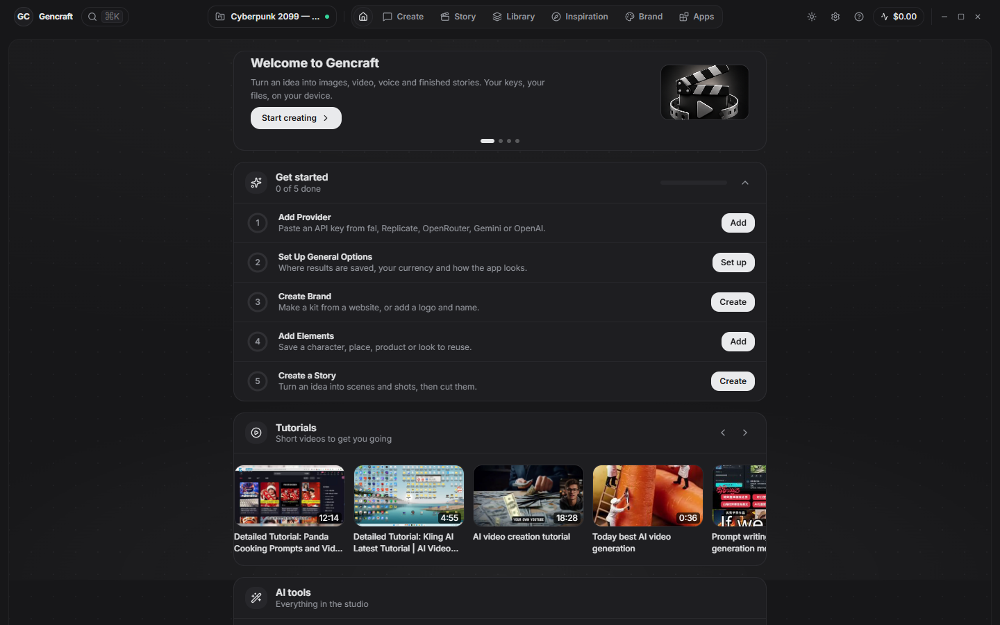
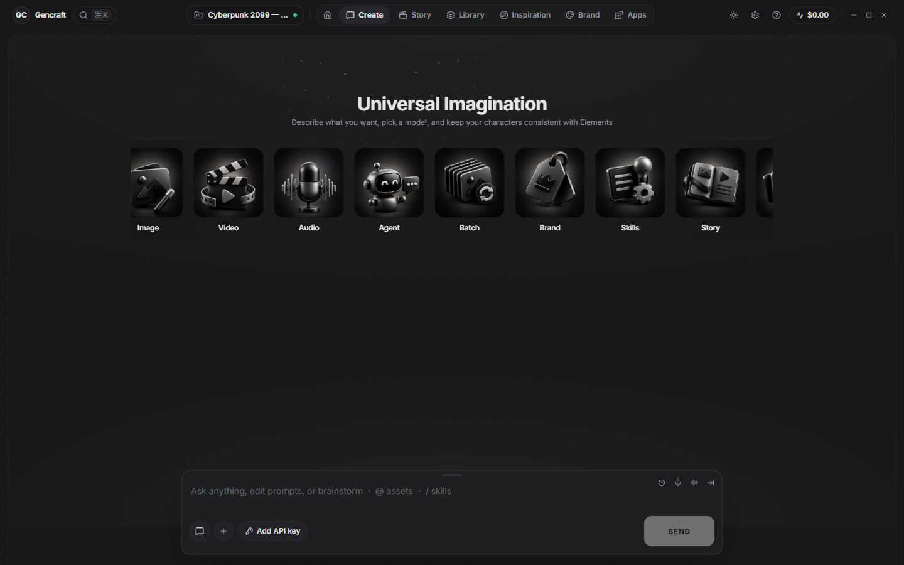
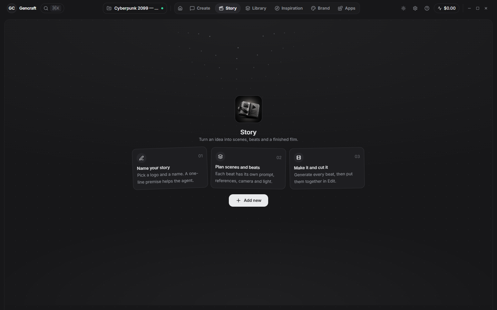
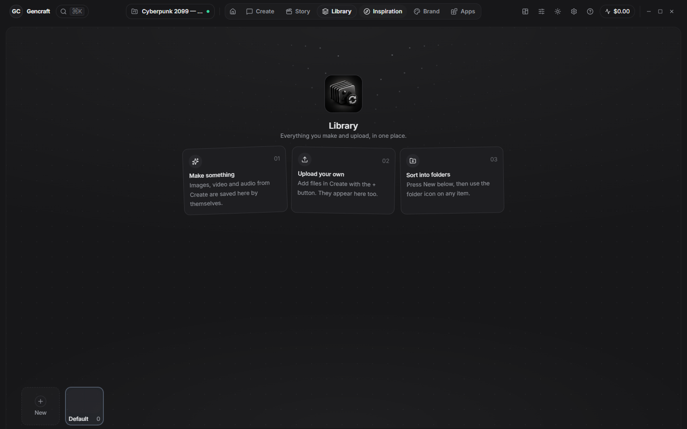

# Gencraft

### The AI studio for images, video, voice and finished stories, on your desktop.

Bring your own provider keys. Pay the models directly. Keep every file on your own device.

[Docs](https://kadamraval.github.io/gencraft/docs/) · [Download](#download) · [Quick start](#quick-start) · [What you can make](#what-you-can-make) · [Models and prices](#one-model-database-for-every-provider) · [Privacy and security](#privacy-and-security) · [Updates](#updates) · [FAQ](#faq)

---

## What is Gencraft?

Gencraft is a desktop app for making **images, video, voice, music and complete stories** with AI. You do not buy credits and you do not subscribe: you paste an API key from the providers you like (fal, Replicate, OpenRouter, OpenAI, Gemini) and Gencraft sends your prompt straight to them. The provider bills you at its own price, and Gencraft shows you an estimate before every run.

It is built for people who want the **newest models from every maker in one place**: Flux, Nano Banana, Seedream, Kling, Seedance, Veo, Wan, Hailuo, Runway, ElevenLabs and many more, with the exact settings each model accepts, without learning each provider's website.

> If you are looking for a desktop alternative to hosted AI studios such as Higgsfield, Freepik's AI suite, OpenArt or Midjourney, with your own keys and your own files, this is what Gencraft is for.

## Download

Gencraft runs as a normal installed app on **Windows, macOS and Linux**. You do not need to install Node, Rust or anything else.

| System | File | Notes |
|---|---|---|
| Windows 10 and 11 | `Gencraft_x.y.z_x64-setup.exe` | If Windows SmartScreen warns about an unknown publisher, choose **More info**, then **Run anyway**. |
| macOS (Apple Silicon and Intel) | `Gencraft_x.y.z_universal.dmg` | Drag Gencraft to Applications. The first time, right-click the app and choose **Open**. |
| Linux | `.AppImage` or `.deb` | For the AppImage: make it executable (`chmod +x Gencraft*.AppImage`), then run it. |

Gencraft is in **beta**: features may change and some things are rough, so please [report problems](https://github.com/kadamraval/gencraft/issues). Installers are attached to every release at **<https://github.com/kadamraval/gencraft/releases>** (the download page at <https://kadamraval.github.io/gencraft/docs/download/> shows each file with its checksum). After the first install, the app updates itself (see [Updates](#updates)).

## Quick start

1. **Add one key.** Open **Settings → Providers**, pick a provider, paste its API key and press **Test**. A green result means it works.
2. **Choose where results go.** Open **Settings → General** and pick a save folder (a default is used until you do).
3. **Make something.** Go to **Create**, choose Image, Video or Audio, pick a model (the row shows what it accepts and what it costs), write a prompt and press **Send**.
4. **Reuse and refine.** Add references with the **+** menu, attach saved **Elements** (characters, places, products, looks) and keep going while earlier runs finish.
5. **Tell a story.** Open **Story**, write or generate a script, plan scenes and beats, generate every shot and cut them together on the timeline.

The **Get started** list on Home ticks each step off for you, and **Help** inside the app explains every screen.

## What you can make

<table>
<tr>
<td width="50%" valign="top">

### Create
Images, video, voice and music from a prompt.
- Exact settings for every model: aspect ratio, resolution, duration, seed, audio on or off, number of images
- Price estimate before each run and a running cost in the top bar
- Several runs at once; the rest wait in line and start by themselves
- If a model fails, the next one in your chain is tried
- **Agents** (Paid): plan the work, run a batch, follow your skills, and ask before they spend

</td>
<td width="50%" valign="top">

</td>
</tr>
<tr>
<td width="50%" valign="top">

</td>
<td width="50%" valign="top">

### Story and Edit
From an idea to a finished cut.
- Overview, **Cast** (characters, locations, props, products), **Script** in standard screenplay format, and a beat board with a prompt, references, camera and light for every shot
- A timeline editor: blade, select and split tools, trimming, transitions, effects, looks, text and captions
- An **Agent** that writes and rewrites the script, or cuts and captions on the timeline

</td>
</tr>
<tr>
<td width="50%" valign="top">

### AI tools on any file
Work on a picture, clip or sound you already have. Each tool lists the models that can really do the job, best first, on the providers you have keys for; pick one or let the app choose.
- **Image:** upscale, remove background, remove object, restyle, relight, outpaint, restore faces, colorize, edit
- **Video:** upscale, remove background, remove object, restyle, relight, extend, slow motion, denoise, colorize, reframe to 9:16, lip-sync, dubbing, motion transfer, edit
- **Audio:** transcribe, voice isolation, noise reduction, voice changer, stem splitting, text to speech, music, sound effects
- Local, free tools for the cut itself: remove silence, find scenes, beat sync, auto ducking, match colour, fades and markers

</td>
<td width="50%" valign="top">

### Library, brand kits and elements
- Every result and upload in one **Library**, filed by project and your own folders, with a warning before it fills the disk
- **Brand kits:** logos (light, dark, mono), colours, Google Fonts and products, fetched from a website
- **Elements:** reusable characters, places, products, props, cameras, lights and styles, sent to the model as references or added to your prompt

</td>
</tr>
</table>

## One model database for every provider

Gencraft does not guess what a model can do. A signed **standard model database** records, for the latest and most popular image, video and audio models on **fal, Replicate, OpenRouter, OpenAI and Gemini**:

- what each model can do (text to image, image edit, text to video, image to video, lip-sync, upscale, transcription and more, since one model often does several jobs),
- the exact settings it takes,
- what it costs and how that is billed (per image, per second, per token, per minute or per compute second),
- where it runs, with the best choice ranked first and backups behind it.

It is **rebuilt every day** from the providers' own live lists and checked before it is published. The build stops, instead of publishing, if a top model has no readable price, if a provider's list suddenly shrinks, or if a whole kind of model (for example speech or transcription) is missed. The app downloads the newest copy on the schedule you choose and keeps the last good one if anything goes wrong. Where a provider truly has no model for a job (for example OpenAI has no video model), the tool says so and names what to add.

## Privacy and security

- **Your keys stay on your device.** They are never written into backups or the model database. Gencraft has no server of its own; the app talks to the providers directly.
- **Your files stay on your device.** Results are saved to a folder you choose. Backups go only where you send them: a folder, Google Drive or Dropbox.
- **Optional app lock.** A master password locks the screen; it is stored only as a salted hash.
- **Signed data and updates.** The model database, content packs and app updates are signed, and the app ignores anything whose signature does not match the key it carries.
- **Careful repository.** Signing keys are never committed. Every push is scanned for secrets, dependencies are audited weekly, security fixes arrive automatically and workflow tokens are read-only.

Read [SECURITY.md](SECURITY.md) to report a problem privately.

## Updates

You choose how often Gencraft looks for updates, once, in **Settings → General → Updates**: **every day, every week, every month, or only when you click**.

- **The app itself** updates in place on the desktop: a signed update is downloaded, checked, installed and the app restarts.
- **Models, prices and abilities** refresh from the daily database, so new models appear without an app update.
- **Effects, transitions, caption styles, elements and templates** arrive as signed content packs the same way.

## Supported providers

| Provider | What it brings |
|---|---|
| **fal** | The widest set of image, video, audio and tool models |
| **Replicate** | Community and official models, including many tools |
| **OpenRouter** | Image, video, speech and transcription models from many makers |
| **OpenAI** | Image, speech and transcription models |
| **Gemini** | Image, video, speech and transcription models |

You need a key for at least one provider; each additional key widens the choice of models.

## FAQ

**Do I need a powerful computer or a GPU?** No. The models run at the providers. Any computer that runs the installer works.

**Does Gencraft cost money?** Gencraft is free and open source, with no credits. Paid adds Agents, Connectors, building your own Apps and email support, and lifts the one-project limit: **One Year, $39** or **Lifetime, $99**, same features. You pay each provider directly for what you run, and the app shows an estimate before every run. See [Free and Paid](https://kadamraval.github.io/gencraft/docs/pricing/).

**Where are my files?** In the save folder you choose (by default `Documents/Gencraft` on the desktop). The app keeps a Library of everything you made and uploaded.

**Which models are included?** Whatever the five providers offer: the database tracks the latest and most popular models of the main makers across image, video and audio, and refreshes daily.

**Can I use models that are not in the list?** Yes: add your own model by provider and id, test it with one small run, and rename or remove it later.

**Is my API key safe?** It is stored on your device, never put in a backup and never sent anywhere except to the provider it belongs to. Treat your computer like the key: anyone who can open the app can use it, so set the master password if others share the machine.

**What if a provider has no model for a tool?** The tool card says so and tells you which provider to add.

## Keywords

AI image generator, AI video generator, text to video, image to video, AI voice generator, text to speech, AI music generator, AI upscaler, remove background, lip sync, AI storyboard, AI story maker, AI video editor, AI agent, AI model prices, bring your own API key (BYOK), desktop app for Windows, macOS and Linux, fal.ai, Replicate, OpenRouter, Google Gemini, OpenAI, Flux, Nano Banana, Seedream, Kling, Seedance, Veo, Wan, Hailuo, Runway, ElevenLabs, Higgsfield alternative, Freepik alternative, OpenArt alternative, Midjourney alternative.

## For contributors

Gencraft welcomes help: bug reports, model requests, guide fixes, content packs and small fixes. Start with [CONTRIBUTING.md](CONTRIBUTING.md); building from source is in [docs/DEVELOPING.md](docs/DEVELOPING.md). Release notes are in [CHANGELOG.md](CHANGELOG.md).

## Licence

Gencraft's source code is open source under the **GNU Affero General Public License v3.0** ([LICENSE](LICENSE)). The name Gencraft and its logo are trademarks and are not covered by that licence ([TRADEMARK.md](TRADEMARK.md)). The Agent and the App builder are part of the paid plan of the official app and are not in this source; a build made from this source has stand-ins for them. Content packs carry their own licence inside each pack.

---

Gencraft is in early development. Source under AGPL-3.0; the name is a trademark.

